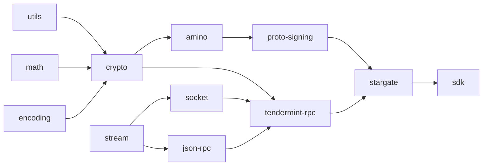

<p align="center">
  
</p>

# BKC Lib

The JavaScript client stack for **BKC** - a Cosmos chain that signs with
ML-DSA-65 (FIPS 204) instead of secp256k1, and runs an EVM over the same
accounts.

```sh
npm i @bkc-network-lib/sdk
```

```ts
import { connectBkcWallet, Contract } from "@bkc-network-lib/sdk";

const { signer } = await connectBkcWallet(endpoints);
const counter = new Contract(address, abi, signer);

await (await counter.set(42)).wait();
```

You write ethers. Underneath, the call travels as a Cosmos message signed with a
post-quantum key, because the chain has no ECDSA key to sign an Ethereum
transaction with. [packages/sdk/README.md](packages/sdk/README.md) is the guide.

This is a fork of [CosmJS](https://github.com/cosmos/cosmjs) - see
[Relationship to CosmJS](#relationship-to-cosmjs) for what changed and why.

## Packages

Twelve packages publish under the
[`@bkc-network-lib` scope](https://www.npmjs.com/org/bkc-network-lib). Most
applications need only the first one.

| Package                                                                                                                                  | What it is                                                                                                                                  |
| ---------------------------------------------------------------------------------------------------------------------------------------- | ------------------------------------------------------------------------------------------------------------------------------------------- |
| [@bkc-network-lib/sdk](packages/sdk)                                                                                                     | One import for building on BKC: ethers-compatible Provider and Signer, the `bkc.bkc.v1` codec, chain constants and helpers. **Start here.** |
| [@bkc-network-lib/stargate](packages/stargate)                                                                                           | Cosmos SDK 0.40+ client - accounts, bank, staking, governance, and broadcasting                                                             |
| [@bkc-network-lib/proto-signing](packages/proto-signing)                                                                                 | Protobuf (Direct) signing and the ML-DSA-65 wallets                                                                                         |
| [@bkc-network-lib/amino](packages/amino)                                                                                                 | Address, public key and signature encoding                                                                                                  |
| [@bkc-network-lib/crypto](packages/crypto)                                                                                               | Hashing, ML-DSA-65 (FIPS 204), HD derivation, KDFs, keystore encryption                                                                     |
| [@bkc-network-lib/tendermint-rpc](packages/tendermint-rpc)                                                                               | RPC client for the CometBFT layer                                                                                                           |
| [@bkc-network-lib/encoding](packages/encoding)                                                                                           | hex, base64, bech32, utf8                                                                                                                   |
| [@bkc-network-lib/math](packages/math)                                                                                                   | Safe integers and decimals for token amounts                                                                                                |
| [@bkc-network-lib/utils](packages/utils)                                                                                                 | Assertions and small helpers                                                                                                                |
| [@bkc-network-lib/stream](packages/stream) · [@bkc-network-lib/socket](packages/socket) · [@bkc-network-lib/json-rpc](packages/json-rpc) | Transport plumbing the RPC client is built on                                                                                               |

`cosmwasm`, `cosmwasm-stargate`, `ledger-amino`, `faucet` and `faucet-client`
stay in the repository but are not published: BKC runs an EVM rather than
`x/wasm`, and Ledger has no ML-DSA-65 applet, so none of them can work against
this chain.

### The dependency tree

Every package depends only on lower-level ones, and the graph has no cycles.
That is what lets an application pull in `@bkc-network-lib/encoding` without
dragging a chain client along with it.



## Documentation

[packages/sdk/README.md](packages/sdk/README.md) is the guide: installing,
writing ethers against the chain, what works and what cannot, connecting to a
wallet extension in the browser, and the Cosmos side for staking and governance.

For adding a chain module of your own, see
[CUSTOM_PROTOBUF_CODECS.md](packages/stargate/CUSTOM_PROTOBUF_CODECS.md).

## Supported JS environments

1. Node.js 22+
2. Modern browsers (Chromium/Firefox/Safari)
3. Browser extensions (Chromium/Firefox)

The target standard is ES2022. There is no WebAssembly anywhere in the tree -
the cryptography is pure JavaScript, through `@noble/*` and `@scure/bip39`,
which is what makes it run unchanged inside a browser extension.

### Bundling for the browser

Webpack 5 stopped substituting Node built-ins automatically, so a browser or
extension build has to say it does not want them:

```js
module.exports = [
  {
    // ...
    plugins: [
      ...,
      new webpack.ProvidePlugin({
        Buffer: ["buffer", "Buffer"],
      }),
    ],
    // ...
    resolve: {
      fallback: {
        buffer: false,
        crypto: false,
        events: false,
        path: false,
        stream: false,
        string_decoder: false,
      },
    },
  },
];
```

## Relationship to CosmJS

This is a fork of [CosmJS](https://github.com/cosmos/cosmjs), taken at version
0.39.0 and licensed Apache-2.0. The upstream authors wrote most of the code
here, and `NOTICE` records that as the licence requires.

What the fork changes:

- **ML-DSA-65 signing.** BKC has no secp256k1 keys, so `crypto`, `amino` and
  `proto-signing` gained FIPS 204 key derivation, signing and address handling.
- **EVM over Cosmos.** The chain refuses `eth_sendRawTransaction`, so contract
  calls travel as `/bkc.bkc.v1.MsgExecuteEvmCall`. `@bkc-network-lib/sdk` is the
  package that hides this behind an ordinary ethers `Signer`.
- **The `@bkc-network-lib` scope**, applied to every package including the
  untouched ones, so an application can never resolve one of each.

`cosmjs-types` is not part of the fork and keeps its name: that is the Cosmos
team's protobuf package, installed from npm like any other dependency.

Versions restart at 1.0.0 and no longer track upstream's. The history here
starts at a snapshot of 0.39.0 rather than carrying CosmJS's commits, so there
is no shared ancestor to merge against: to pull a later upstream fix, read it at
[cosmos/cosmjs](https://github.com/cosmos/cosmjs) and apply it by hand.

## Development

See [HACKING.md](HACKING.md).

## Get in touch

- [GitHub issues](https://github.com/bkc-network/bkc-lib/issues) for bugs and
  feature requests in this fork

Questions about CosmJS itself, rather than about BKC, belong
[upstream](https://github.com/cosmos/cosmjs/issues) - please do not file those
here, and do not file BKC issues there.
